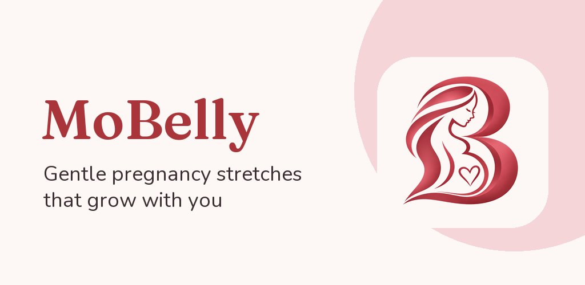
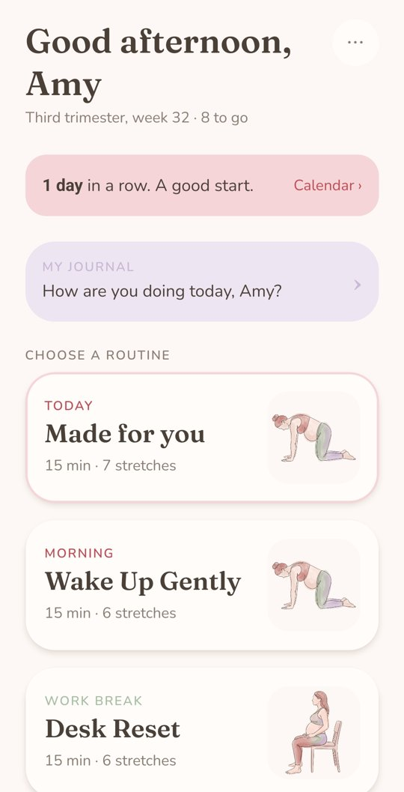
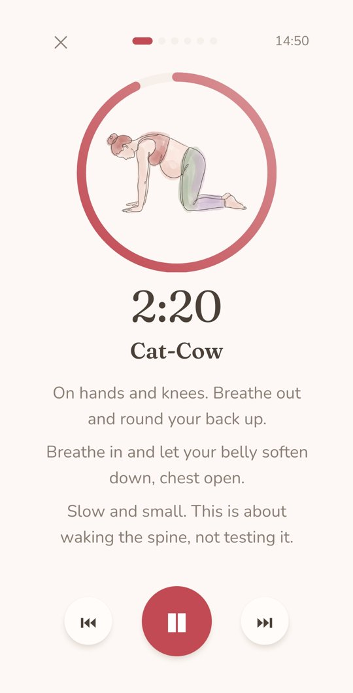
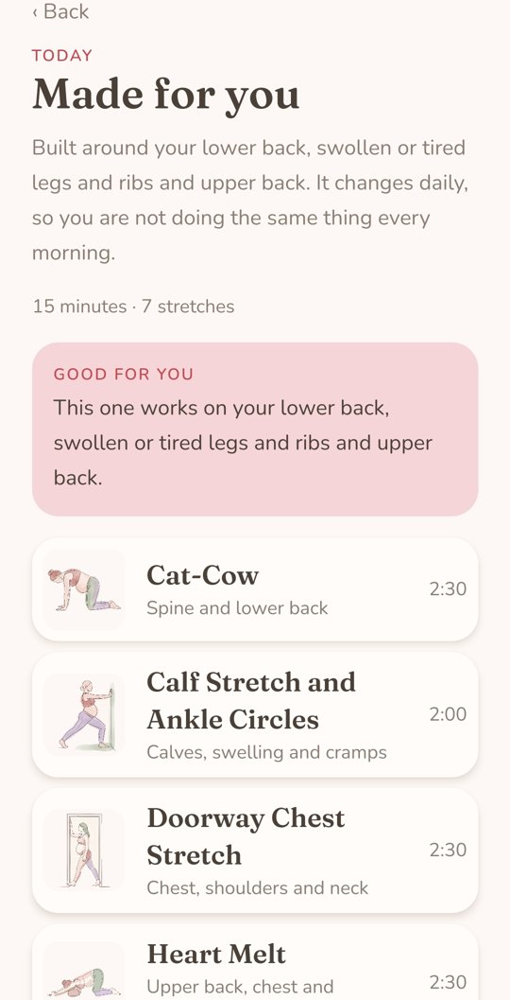
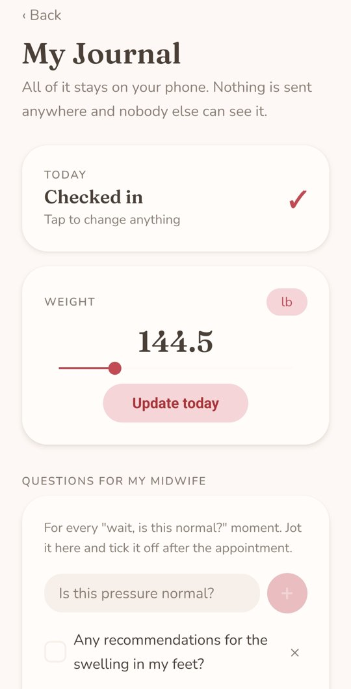
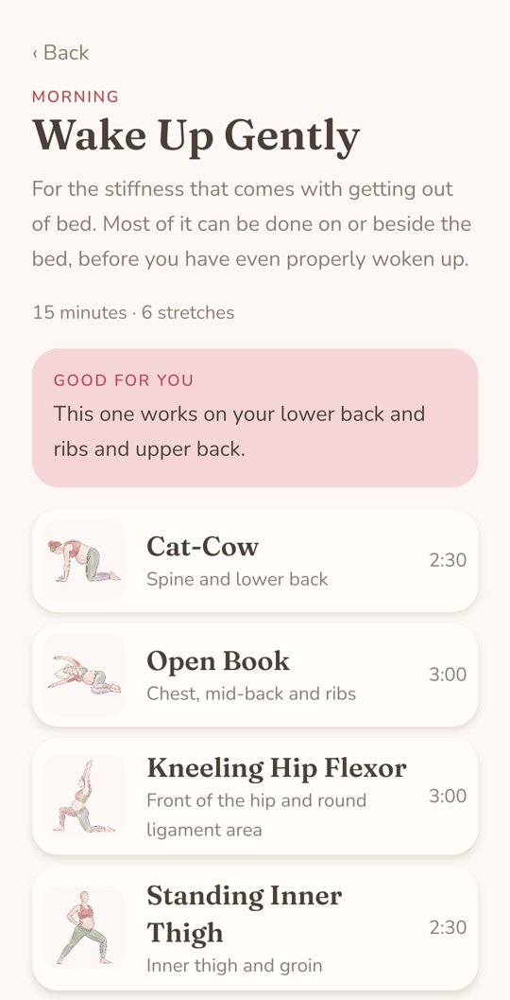
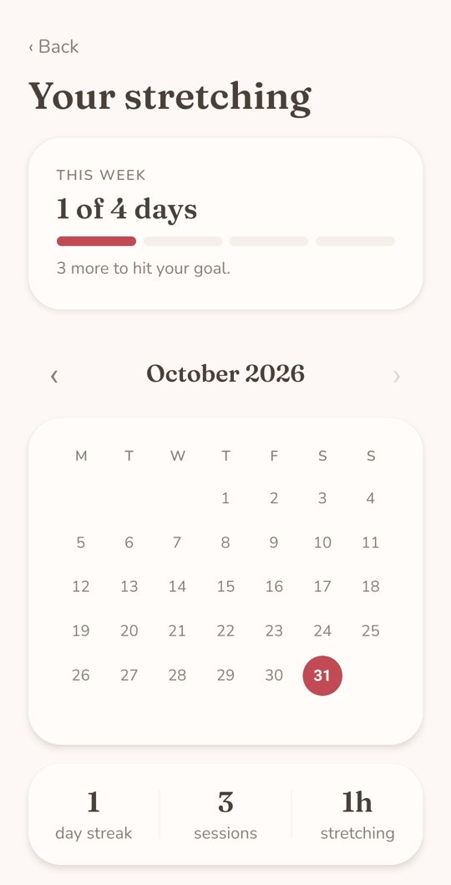
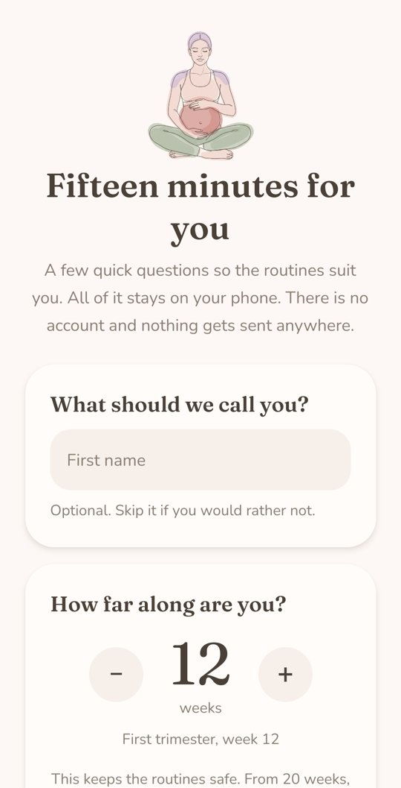
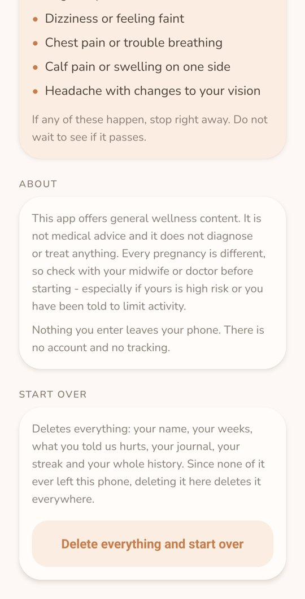

# MoBelly: gentle pregnancy stretches

**A phone app with 15-minute stretching routines for pregnancy that adjust to how far along you are.** One codebase for iPhone and Android, built with React Native and Expo. Version 1 is finished and being prepared for the Google Play Store.

This is a showcase repo. The app is a commercial product, so the full source stays private. Here you'll find the screenshots, the design thinking, and a few of the files that matter most.

  
  
  
  

  
  
  
  

## Why I built it

Most fitness apps either ignore pregnancy or bury the safety rules in small print. I wanted a simple, calm app where the app itself can't show something unsafe.

## What it does

- **Three fixed routines for real days:** Wake Up Gently (on or beside the bed), Desk Reset (nothing on the floor) and Wind Down (slow and cushioned). Each one is exactly 15 minutes.
- **Made for you:** a routine built from the aches and goals you pick, which changes day to day so it doesn't go stale.
- **A calm player:** a countdown ring, clear cues, side switches announced, soft sounds. 31 illustrated poses.
- **Journal, calendar, streaks and gentle reminders.** Questions for your midwife can be saved as they come up.
- **Private by design.** Everything stays on the phone. No account, no tracking, and one button deletes it all.

## Safety lives in the data, not the screens

The stretches follow ACOG guidance and prenatal physiotherapy sources. The rules are built into the content and enforced in one place, so no screen can get it wrong:

- **Nothing lying flat on the back after 20 weeks.** Those stretches carry a flag and a safe alternate. [`trimester.ts`](code-samples/trimester.ts) swaps them before any screen sees the routine. It's the only function screens are allowed to use to get a routine's stretches.
- **Some poses are left out entirely:** belly-down poses, deep twists, deep backbends, inversions and planks.
- **The 80% rule.** Pregnancy hormones loosen ligaments, so feeling suddenly more flexible isn't progress. Every cue says stop short.
- **A self-check on every dev start.** [`contentCheck.ts`](code-samples/contentCheck.ts) confirms that every routine still totals exactly 15 minutes at every stage, that every flagged stretch has a working replacement, and that every stretch has a drawing. If someone edits the content and breaks a rule, it shouts.

## Code samples

| File | Why it's interesting |
|---|---|
| [`trimester.ts`](code-samples/trimester.ts) | The safety logic. Week in, safe stretch list out |
| [`useRoutineTimer.ts`](code-samples/useRoutineTimer.ts) | The timer engine. It uses wall-clock time, not counted ticks, because phones throttle timers and a 15-minute routine would drift. Backgrounding the app auto-pauses it: if you went to answer the door, you weren't stretching |
| [`routineBuilder.ts`](code-samples/routineBuilder.ts) | Builds the personalised routine. Three rules it won't break: exactly 15 minutes, nothing unsafe for your week, and always a gentle opener and a breathing close |
| [`contentCheck.ts`](code-samples/contentCheck.ts) | The content self-check described above |
| [`CountdownRing.tsx`](code-samples/CountdownRing.tsx) | The ring that empties as each stretch runs |

These are excerpts from the full app. They import other files that aren't included here.

## Built with

Expo SDK 58 · React Native 0.88 · React 19 · TypeScript · expo-router. Pose illustrations are AI-generated from one approved style reference, then processed by script so all 31 match. The app icon is my partner's design.

---

Built by Joshua with Claude Code, 2026. © All rights reserved.
